# 智旅纪手账项目 UML 设计说明

设计依据：当前工作区源码与实际已实现功能。文档日期：2026 年 10 月 11 日。

本说明提供 1 张系统用例图、3 张类图、3 张时序图、3 张对象状态图和 3 张活动图，共 13 段可独立渲染的 PlantUML 代码，以及 actor-goal lists 和 3 个核心用例的完整规约。

原要求第 4 项同时出现“状态图”和“3 个类图”，本说明按章节含义提供三个对象状态图，并在类图章节另外提供三张类图，覆盖两种理解。第 5 项的“互动图”按其描述的“活动图”处理；第 3 项的交互图采用 UML 时序图。

## 一、系统范围与用例设计

### 1.1 系统边界

智旅纪把用户的旅行照片与补充记录整理为可编辑的手账，提供本机草稿、成品预览、PNG 下载，以及自愿公开到大厅的功能。

系统边界包含浏览器前端、Flask 后台、SQLite 私有任务与大厅存储、图片渲染器、本机草稿与服务器媒体文件。图像理解、文字生成和地图地理编码属于外部协作系统。当前图像理解使用华为云 Qwen；文字生成配置为 DeepSeek 官方；地理编码使用百度地图。

当前没有正式账号注册、登录、评论、点赞、关注、收藏、管理员审核或帖子恢复功能。因此不把这些功能画入现有系统模型。用户身份来自浏览器 Cookie 中的 `owner_id`，作者昵称仅是展示信息。

三个核心用例统一编号如下：

| 编号 | 核心目标 | 主要成果 |
|---|---|---|
| UC01 | 生成旅行手账 | 结构化的手账初稿与可恢复的任务结果 |
| UC02 | 编辑并导出手账 | 与当前预览一致的 PNG 成品 |
| UC03 | 发布成品到大厅 | 独立公开作品快照、话题与详情链接 |

### 1.2 Actor-goal lists

#### A1：大厅访客

| 目标编号 | 参与者目标 | 对应用例 |
|---|---|---|
| A1-G1 | 浏览最新公开作品与分页加载 | UC11 浏览大厅作品 |
| A1-G2 | 按关键字或话题找到作品 | UC12 搜索／按话题筛选 |
| A1-G3 | 查看作品详情与完整长图 | UC13 查看作品详情与长图 |

#### A2：创作者

创作者具有大厅访客的浏览能力。以下为新增的创作目标。

| 目标编号 | 参与者目标 | 对应用例 |
|---|---|---|
| A2-G1 | 将有序照片和记录整理为手账 | UC01 生成旅行手账 |
| A2-G2 | 修改内容、照片排版并下载成品 | UC02 编辑并导出手账 |
| A2-G3 | 自愿公开当前成品 | UC03 发布成品到大厅 |
| A2-G4 | 调整正文语气，保留原有事实 | UC04 调整文案语气 |
| A2-G5 | 撤销或恢复一次编辑 | UC05 撤销／重做编辑 |
| A2-G6 | 继续上次本机保存的创作 | UC06 恢复本机草稿 |
| A2-G7 | 清除当前设备的创作记录 | UC07 清空本机草稿 |
| A2-G8 | 复制当前手账文案 | UC08 复制手账文案 |
| A2-G9 | 继续查看任务或重试失败步骤 | UC09 查看／重试生成任务 |
| A2-G10 | 了解五种风格的排版效果 | UC10 查看风格样张 |

#### A3：发布者

发布者是创作者在管理已发布作品时的角色，不是另一种账户。

| 目标编号 | 参与者目标 | 对应用例 |
|---|---|---|
| A3-G1 | 查看本浏览器身份发布的作品 | UC14 查看我的发布 |
| A3-G2 | 撤回自己的公开作品 | UC15 撤回自己的发布 |

#### 外部协作参与者

| 参与者 | 协作职责 | 对应用例 |
|---|---|---|
| A4 图像理解服务 | 批量描述用户提供的照片 | UC01 的照片分析 |
| A5 文字生成服务 | 按风格生成正文；按语气改写原稿 | UC01、UC04 |
| A6 地理编码服务 | 有 GPS 且未手填地点时提供地址参考 | UC01 的条件性自动定位 |

外部服务是辅助参与者，不发起创作目标。浏览器、数据库与后台线程属于系统内部组成，不作为业务 actor。

### 1.3 用例关系说明

- 创作者泛化到大厅访客，发布者泛化到创作者；空心三角指向较一般的角色。
- `include` 从基本用例指向必需的子用例。例如生成包含素材处理、照片分析和正文撰写；发布包含明确公开确认和保存独立公开成品。
- `extend` 从可选行为指向被扩展用例，并标明守卫。自动定位的守卫为“有 GPS 且未填写地点”；搜索筛选是浏览大厅时的可选行为。
- UC01、UC02、UC03 是独立用户目标，结果可以衔接，但不使用 `include` 表示执行先后。生成并不必然要求编辑或公开发布。
- 语气调整、撤销重做、恢复草稿、失败重试、撤回发布保留为独立目标，并在核心规约中描述其关联场景。

### 1.4 系统用例图代码

源文件：[01_use_cases.puml](/Users/lujiahao/Documents/手帐/docs/uml/01_use_cases.puml)。

<!-- diagram: 01_use_cases.puml -->

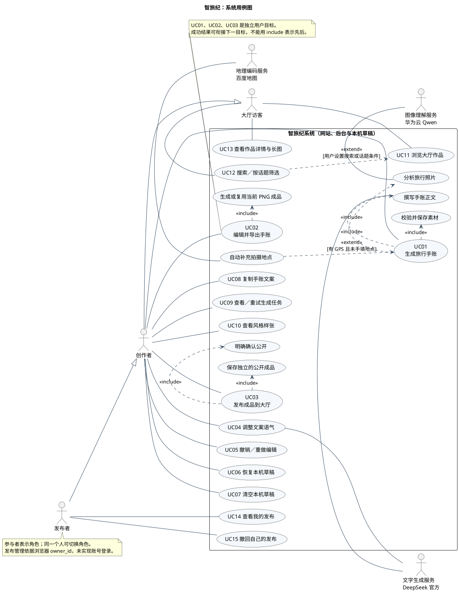

## 二、三个核心用例规约

### 2.1 UC01：生成旅行手账

| 规约项 | 描述 |
|---|---|
| 用例编号与名称 | UC01，生成旅行手账 |
| 范围与级别 | 智旅纪系统；用户目标级 |
| 主参与者 | 创作者 |
| 协作参与者 | 图像理解服务、文字生成服务；地理编码服务为条件性协作 |
| 触发事件 | 点击“生成旅行手帐”或“用素材重新生成” |
| 前置条件 | 已选择至少一张可读取的支持格式照片；风格与选填记录合法；当前页面允许开始生成 |
| 输入 | 1～9 张有序照片、风格、可选地点／日期／天气／心情／感受 |
| 输出 | 任务状态、正文、title/body/tags 结构、照片引用及日期地点提示 |
| 成功后置条件 | 任务成为 completed，保存有效结果；前端复制结果为可编辑快照，尝试保存本机草稿并开始排版预览 |
| 最低失败保障 | 已有作品不被错误覆盖；成功阶段已持久化；错误不暴露密钥或上游响应；本机保存失败会提示用户 |

**主成功流程**

1. 创作者添加、移除或调整照片顺序，选择五种风格之一，并填写可选记录。
2. 浏览器校验输入并保留已有作品，提交创建任务请求。
3. 后端检查图片格式、大小、像素及表单，提取元信息，纠正方向，把上传副本规范化为去除 EXIF 的 JPEG，登记所有者。
4. 后端在并发额度允许时创建 queued 任务并返回 202；后台线程执行，前端观察实际进度。
5. 图像理解服务批量分析照片，后台立即保存有效描述。
6. 后台整理日期与地点。有 GPS 且用户未手填地点时调用地理编码；手填记录优先，多日期／多地点或未知地点产生提示。
7. 文字生成服务依据照片线索、风格与用户记录撰写正文，执行真实性约束。
8. 后端检查正文并解析 title/body/tags，保存 result，设为 completed/done。
9. 浏览器展示结果，尝试保存本机草稿，触发后续成品排版。

**备选与异常流程**

| 编号 | 发生位置 | 处理 |
|---|---|---|
| UC01-A1 | 第 2～3 步，输入不合法 | 提示具体问题；本批次部分已保存的上传副本回滚，用户修正后重新提交 |
| UC01-A2 | 第 4 步，并发额度不足 | 返回 429，回收本批照片；提示等待，不创建新任务 |
| UC01-A3 | 第 6 步，无 GPS、无日期或地图失败 | 使用用户记录与已知内容继续，提示手动确认，不把地图失败当作写作失败 |
| UC01-A4 | 第 5／7 步，识图或文字 API 失败 | 记录 failed、失败阶段、retryable；失败不替换已有作品 |
| UC01-A5 | 失败后，允许且选择重试 | 校验 owner、failed、retryable 与额度，重新排队；复用已保存的描述和地点结果 |
| UC01-A6 | 观察任务时浏览器超时或离开页面 | 后台任务可能继续；可继续查看或从草稿恢复任务引用，不认定后台已取消 |
| UC01-A7 | 服务重启发现未完成任务 | 设为可重试失败，保留已完成阶段 |
| UC01-A8 | 任务或照片已不可访问 | 提示重新选择素材；照片访问错误不可直接重试，浏览器已有文案继续保留 |

**业务规则**

- 支持 JPG/JPEG、PNG、WebP；最多 9 张，单张最多 16 MiB，请求总大小最多 50 MiB；单图最多 3000 万像素。
- 每个 owner 最多 2 个 queued/running 任务，全系统最多 12 个；执行线程池当前为 3 个 worker。
- 五种风格为小红书风、INS 风、日杂风、胶片风、Muji 极简风。
- 用户确认信息优先；不把不确定识别或附近景点写成到访经历。当前主生成流程未调用附近景点检索。
- 私有照片保留 7 天；创建超过 7 天且非 queued/running 的任务可清理。清理由请求触发的周期检查完成，非后台定时精确到秒执行。

### 2.2 UC02：编辑并导出手账

| 规约项 | 描述 |
|---|---|
| 用例编号与名称 | UC02，编辑并导出手账 |
| 范围与级别 | 智旅纪系统；用户目标级 |
| 主参与者 | 创作者 |
| 协作参与者 | 调整语气时使用文字生成服务；常规排版由本系统完成 |
| 触发事件 | 修改已有作品并点击下载；也可保留原稿直接下载 |
| 前置条件 | 存在已生成或恢复的结果；当前内容可编辑；用于本次排版的私图属于当前 owner 且有效，允许 0 张照片的纯文字成品 |
| 输入 | 结构化标题、正文、标签、成品风格、有序照片引用与日期地点天气等元信息 |
| 输出 | 对应当前内容的 PNG 预览与下载文件 |
| 成功后置条件 | 浏览器下载与当前匹配预览相同的 PNG；尝试保存作品与编辑历史 |
| 最低失败保障 | 当前正文和历史保留；不允许把内容不匹配的旧缓存下载为当前成品 |

**主成功流程**

1. 系统展示已有手账，或恢复本机保存的较新草稿。
2. 创作者修改标题、正文、作品标签、成品风格、日期、天气、地点及照片顺序；也可保留原稿。
3. 浏览器将编辑分组记录到历史，新编辑清空重做栈，并安排自动保存。
4. 浏览器递增预览版本号、中止旧请求、计算当前内容 key；匹配缓存存在时直接复用。
5. 若无匹配缓存，浏览器冻结本次作品快照，提交排版请求；后端检查内容、风格、scale 与私图所有权。
6. 系统渲染结构化内容并返回 PNG。浏览器只接受版本号与内容 key 均匹配的响应，更新预览与缓存。
7. 创作者点击下载，浏览器保存当前预览使用的同一个 PNG Blob。

**备选与异常流程**

| 编号 | 场景 | 处理 |
|---|---|---|
| UC02-A1 | 选择语气调整 | 发送原稿、语气与风格；成功产生可撤销新版本；失败保留原稿 |
| UC02-A2 | 撤销／重做 | 恢复完整结果快照，包括照片顺序与元信息，并重新检查预览匹配 |
| UC02-A3 | 文案为空或超过 12000 字 | 不生成有效预览，提示编辑；空标题本身合法 |
| UC02-A4 | 排版失败或超时 | 保留文字及旧预览，允许重试；旧图 key 不匹配时下载保持禁用 |
| UC02-A5 | 排版期间继续修改 | 使旧请求失效；即便旧响应随后到达也不覆盖新版本 |
| UC02-A6 | 私有照片过期 | 恢复时移除失效引用并保留文字与本地素材；可以排版纯文字版本，重新使用照片需重新生成上传 |
| UC02-A7 | 本机完整保存失败 | 尝试 localStorage 文字后备，提示照片未完整保存；两者都失败则明确提醒 |
| UC02-A8 | 选择复制文案 | 复制当前正文；剪贴板不可用时提示手动选择复制，不改变作品 |

**业务规则**

- 当前页面排版 scale=2，即 1500 像素宽；后台也支持 scale=1，即 750 像素宽。
- 文案总量最多 12000 字；结构化标题可以为空，正文段落与标签由明确字段表达。
- 撤销与重做栈分别限制为 50 项；一次文本编辑按防抖或失焦分组。
- 素材区设置用于下一次生成，成品区设置作用于当前作品。
- 自动排版防抖为 700ms，草稿保存防抖为 450ms；下载不重新请求导出接口。
- 改写只调整表达，保留原稿事实，不补写未知经历。

### 2.3 UC03：发布成品到大厅

| 规约项 | 描述 |
|---|---|
| 用例编号与名称 | UC03，发布成品到大厅 |
| 范围与级别 | 智旅纪系统；用户目标级 |
| 主参与者 | 创作者；成功后可作为该帖子的发布者 |
| 触发事件 | 成品有效时点击“发布到大厅”，填写信息并明确确认公开 |
| 前置条件 | 当前内容与 PNG 预览一致；未在生成或改写；新发布所用私图属于当前 owner 且仍有效，允许纯文字作品 |
| 输入 | 冻结的成品快照、分享标题、说明、昵称、话题、公开确认、幂等 UUID |
| 输出 | 新帖子或已存在的相同帖子、公开媒体 URL 与详情链接 |
| 成功后置条件 | 帖子为 active，公开 PNG 与缩略图独立保存，话题关联完整；大厅可见，本机草稿保留 |
| 最低失败保障 | 表单与作品保留；写入错误回滚本次未提交的数据与文件；超时表示结果未确认，不等于确定未发布 |

**主成功流程**

1. 浏览器确认当前作品与预览匹配，冻结作品的内容、风格、元信息和照片引用。
2. 发布窗口展示当前成品，公开确认默认不勾选；创作者填写分享标题、说明、昵称和可选话题。
3. 系统说明成品中的图片、文字及地点等会公开，创作者明确勾选并提交。
4. 浏览器校验输入、固定本次 payload 与幂等 key，防止提交中的重复点击。
5. 后端校验公开确认与字段，计算规范 payload 指纹，先检查同 owner + key 的幂等结果和发布配额。
6. 新发布继续校验私图归属及有效期，按冻结快照渲染 1500px PNG，生成 JPEG 缩略图。
7. HallService 开启事务，再次校验幂等和额度，排他写入独立媒体、保存帖子、复用话题并保存关联顺序。
8. 事务提交，返回 201 与帖子；浏览器显示详情链接及查看大厅入口。

**备选与异常流程**

| 编号 | 场景 | 处理 |
|---|---|---|
| UC03-A1 | 未确认公开、取消窗口或字段不合法 | 不提交或返回 400；保留私有草稿与表单 |
| UC03-A2 | 同 owner、key、内容相同且原帖 active | 返回原帖子 200；不重复渲染，不消耗第二次发布额度；原私图即使已过期也可确认既有发布结果 |
| UC03-A3 | 同 key 内容改变或帖子已撤回 | 返回 409；客户端变更内容后使用新 key，并按公开确认流程再次提交 |
| UC03-A4 | 达到日发布限额 | 返回 429，不创建新帖子 |
| UC03-A5 | 私图过期或不属于当前 owner | 返回 403，保留作品并提示处理照片 |
| UC03-A6 | 渲染、文件或事务写入失败 | 返回安全错误；回滚未提交的数据库变更，删除本次已创建文件，允许修复后重试 |
| UC03-A7 | 网络超时或响应丢失 | 提示结果尚未确认；相同 payload 重试使用原 key，防止已经提交的作品被重复发布 |
| UC03-A8 | 需要回到编辑区改图 | 关闭窗口后重新编辑，再打开时冻结新快照并再次确认公开 |
| UC03-A9 | 发布后想撤回 | 进入独立 UC15；仅 owner 可软撤回，公开访问立即停止，不修改本机草稿 |

**业务规则**

- 分享标题 1～100 字，说明最多 2000 字，昵称 1～30 字；分享标题与成品图内标题是不同字段。
- 最多 5 个大厅话题，每个 1～20 字；NFKC 规范化、去掉前导井号并按大小写折叠去重。
- 每个 owner 在北京时间每日最多发布 20 篇；撤回不返还当日额度。
- 幂等约束为 `unique(owner, idempotency_key)`；话题关联约束为 `unique(post_id, topic_id)`。
- 公开 PNG 和缩略图独立保存，不随私照的 7 天策略清理。发布后继续编辑草稿不改变已发布图片。
- 昵称不是身份凭据；清除 Cookie、换浏览器或设备后无法凭昵称管理此前发布。

## 三、类图设计

### 3.1 从实现抽象的实体与值对象

本项目以模块函数、SQLite 行、dict/JSON 和浏览器状态实现业务。下列类是软件分析模型，不声称源码存在同名 Python 实体类。`JournalStore`、`HallService` 是实际服务类；控制器、执行器和适配器表示现有模块函数承担的职责。

| 类 | 类型与存放位置 | 核心职责 |
|---|---|---|
| SessionOwner | 概念实体；Cookie 中的 owner_id，无账户表 | 私有照片、任务及帖子所有权 |
| PrivatePhoto | 持久实体；photos 行与私有 JPEG 文件 | 私图登记、访问校验和过期清理 |
| GenerationJob | 持久实体；jobs 行及 record JSON | 四种任务状态、处理阶段、成功缓存与结果 |
| PhotoReference | 任务内嵌值对象 | 有序照片名与拍摄时间／GPS／地址线索 |
| JournalResult | 任务内嵌值对象 | 服务器生成的正文及结构化初稿 |
| LocalDraft | 浏览器聚合；IndexedDB 与文字后备 | 本机素材、作品版本、待处理任务和缓存 |
| JournalSnapshot | 草稿内值对象 | 当前作品、撤销和重做的独立内容快照 |
| RenderedPreview | 浏览器值对象 | 与内容 key 对应的 PNG Blob |
| HallPost | 持久实体；hall_posts | 公开分享信息、幂等性及展示状态 |
| PublicMedia | 文件值对象；公开媒体目录 | 独立 PNG 和 JPEG 缩略图 |
| Topic | 持久实体；hall_topics | 可被多篇帖子复用的话题 |
| PostTopic | 关联实体；hall_post_topics | 帖子与话题的多对多关联及顺序 |
| TravelInput、Sections | 内嵌值类型 | 旅行记录；标题、正文与作品标签结构 |

### 3.2 关联类型与多重性

| 关系 | UML 类型 | 多重性与原因 |
|---|---|---|
| SessionOwner—PrivatePhoto／GenerationJob／HallPost | 普通关联 | 每条记录属于 1 个 owner；一个 owner 可对应 0..* 条记录。没有账户表外键 |
| GenerationJob—PhotoReference | 组合 `*--` | 一个任务组合 1..9 个内嵌照片引用；随任务 JSON 一同存取 |
| PhotoReference—PrivatePhoto | 普通可选关联 | 当前创建路径每个私图至多属于一个任务引用；每个引用指向 0..1 个仍可访问私图，过期后可以不存在 |
| GenerationJob—JournalResult | 组合 | 一个任务最多 1 个生成结果；初始与失败阶段可为 0 |
| LocalDraft—JournalSnapshot／RenderedPreview | 组合 | 版本及预览属于本机草稿；清空草稿会删除这些本机记录，不删除服务器帖子 |
| LocalDraft—GenerationJob | 普通关联 | pendingJobId 是可选引用；清空本机草稿不代表销毁服务器任务 |
| JournalSnapshot—PrivatePhoto | 普通关联 | 一个快照选用 0..9 张私图；多个版本可引用同一私图，访问仍需有效期与 owner 校验 |
| HallPost—PublicMedia | 组合 | 每个帖子拥有 2 份独立公开媒体：1 PNG 与 1 JPEG 缩略图 |
| HallPost—PostTopic—Topic | 组合与普通关联 | 每帖有 0..5 条话题关联，每关联指向 1 个共享 Topic，每 Topic 可对应 0..* 条关联；帖子与话题整体为多对多 |
| 生成结果→编辑快照、发布帖子→发布时快照 | 依赖 `..>` | 数据在生成或发布时被读取并复制／固化；不新增不存在的 job_id 或内容快照外键 |
| 控制器／执行器→服务 | 调用依赖或普通服务关联 | 使用服务不意味着拥有其生命周期；HallService 注入 JournalStore 不是组合 |

未强行引入空心菱形聚合：共享照片／话题可以用普通关联清楚表达；并非所有“使用”关系都是聚合。领域实体之间没有必要的 is-a 关系，因此不虚构继承。参与者的角色泛化已在用例图表达。

`PhotoReference.position` 是从有序列表推导的属性，非现有单独持久列；`PostTopic.position` 则是数据库实际列。`Sections.tags` 是成品文案标签，`Topic` 是大厅检索话题，二者不能混为同一实体。

### 3.3 全局实体类图

<!-- diagram: 02_class_domain.puml -->

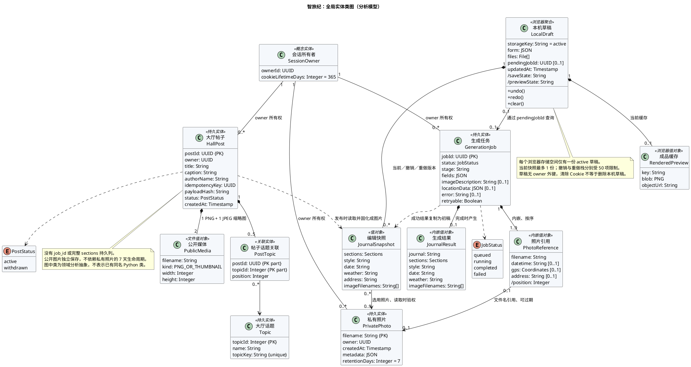

### 3.4 创作子域类图

此图细化任务、初稿、编辑快照与渲染协作职责；TravelInput 与 Sections 是被复制的值类型，使用类型依赖，避免把不同对象中的复制值画成共享实体。

<!-- diagram: 03_class_creation.puml -->

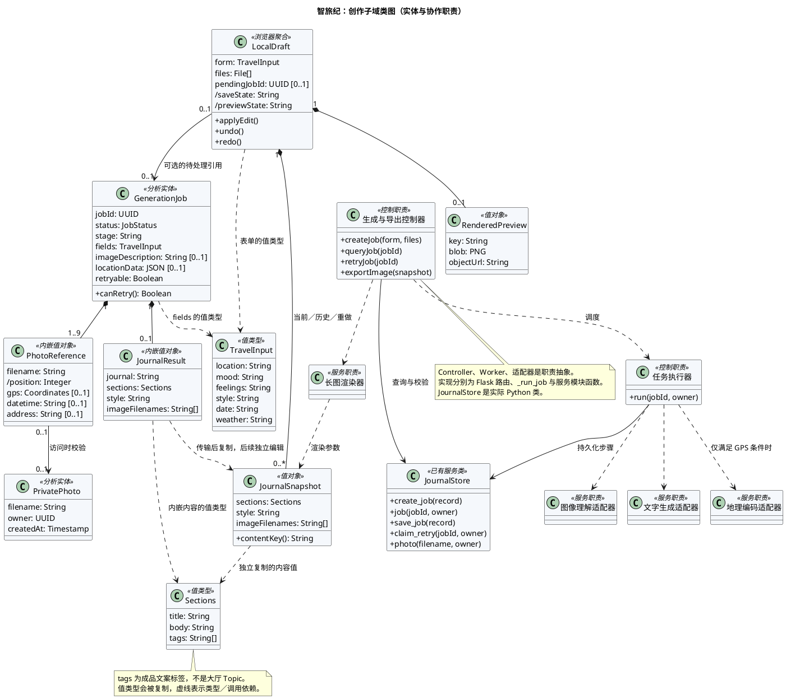

### 3.5 大厅子域类图

此图细化公开媒体、话题关联、发布幂等及服务协作。公开帖子没有对原生成任务的必需关联，也没有对私有照片的持续生命周期依赖。

<!-- diagram: 04_class_hall.puml -->

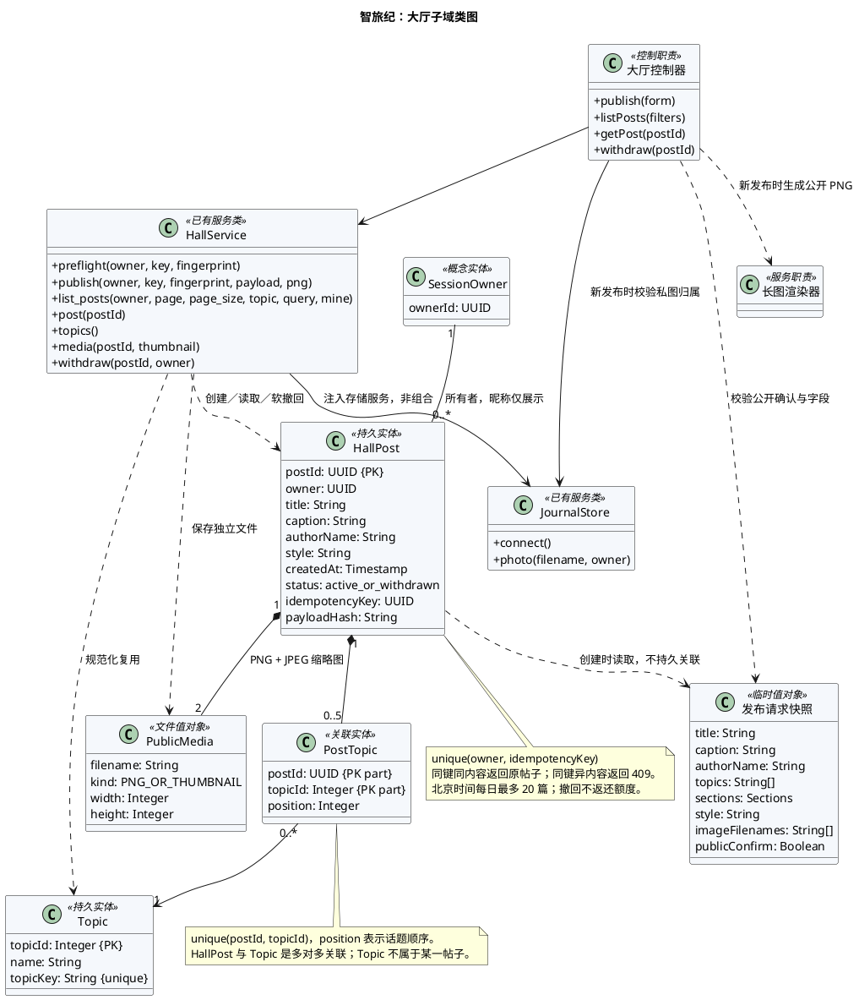

## 四、三个用例的交互图：时序图

生命线采用“参与者—边界—控制—实体／服务”的分析结构。实线消息表示请求或调用，虚线消息表示返回，异步箭头表示后台派发；`alt`、`opt`、`loop`、`par` 分别表达分支、可选、循环和并发交互。

### 4.1 UC01 生成旅行手账

展示创建异步任务、后台与轮询的并行协作、阶段缓存、失败与重试。三种外部处理服务不是被同时并发调用，后台仍按照片分析、地点整理、正文撰写顺序执行。

<!-- diagram: 05_sequence_generate.puml -->

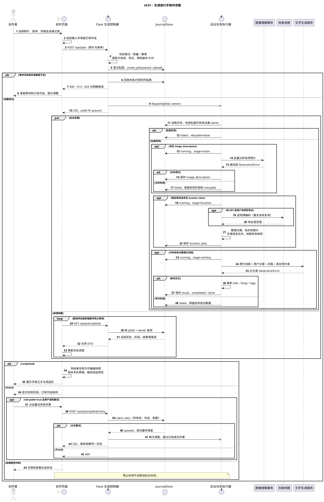

### 4.2 UC02 编辑并导出手账

展示编辑历史、可选改写、预览版本检查及缓存下载。下载行为直接使用与当前作品匹配的 PNG，避免把“点击下载”错误画成新一轮模型生成或服务器排版。

<!-- diagram: 06_sequence_edit_export.puml -->

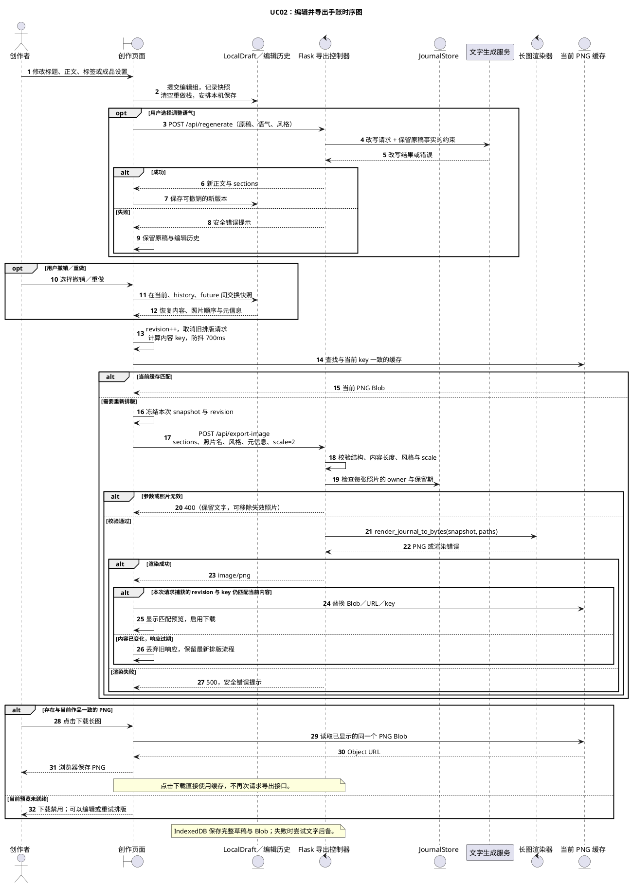

### 4.3 UC03 发布成品到大厅

展示冻结快照、公开确认、两次幂等与配额检查、媒体及数据库事务、响应丢失后的安全确认。

<!-- diagram: 07_sequence_publish.puml -->

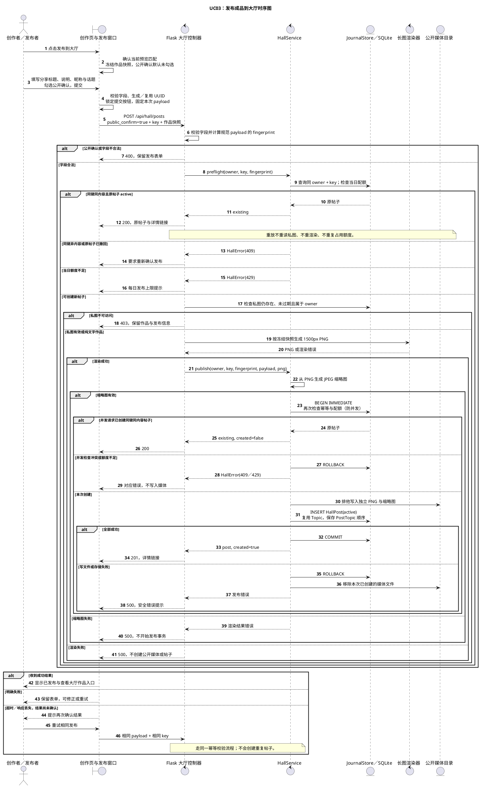

## 五、三个类对象的状态描述与状态图

### 5.1 GenerationJob 任务对象

| 对象状态 | 含义 | 进入条件／动作 | 主要后续事件 |
|---|---|---|---|
| queued | 任务已创建或已重新排队 | 首次创建的 stage=upload；重试保留原阶段与成功缓存 | 执行器启动、照片无效、服务恢复 |
| running | 后台处理正在执行 | stage 可为 vision、location、writing；按缓存选择起始子阶段 | 阶段成功、GenerationError、未知异常、服务恢复 |
| completed | 有效初稿已生成 | 保存 result；stage=done；retryable=false | 创建超过 7 天后的清理 |
| failed | 处理未完成 | 保存安全错误、失败阶段、retryable 与成功缓存 | 满足守卫后重试，或超期清理 |

关键守卫：重试要求 owner 匹配、status=failed、retryable=true，并满足会话与全局并发额度。重试复用成功描述与地点结果，不重新执行这些已完成步骤。照片访问错误的 retryable=false。

`upload/vision/location/writing/done` 是阶段而不是五种顶层状态。任务清理表示对象记录销毁，不建立不存在的 expired 枚举；queued/running 不按任务超期条件删除。

<!-- diagram: 08_state_job.puml -->

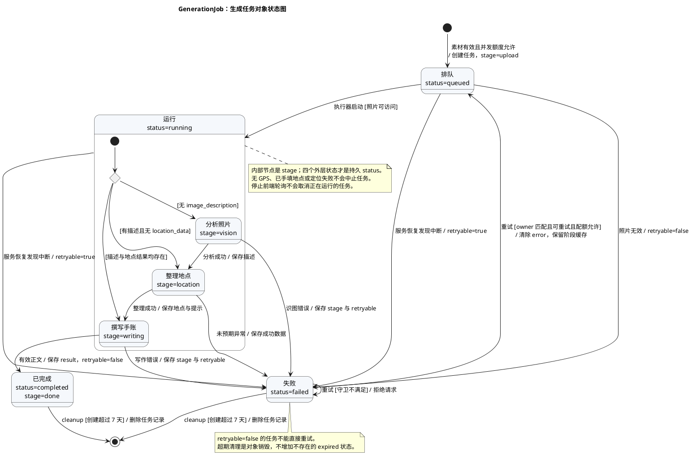

### 5.2 LocalDraft 草稿对象

草稿没有一个现成的统一状态枚举。这里分析的是同一聚合的两组可同时成立的推导状态：保存状态与成品预览状态。它们由计时器、保存结果、作品存在性、预览版本与 key 推导，因此使用复合状态的正交区域。

| 保存状态 | 含义 |
|---|---|
| 恢复中 | 读取 IndexedDB 与 localStorage，选择较新版本并校验照片清单 |
| 恢复完成／空草稿 | 已建立可编辑的本机状态 |
| 待保存 | 变化已发生，等待保存防抖 |
| 保存中 | 完整保存按 Promise 链串行执行，后续修改排队 |
| 完整保存 | IndexedDB 中保存内容、素材 Blob 与可用缓存 |
| 仅文字保存 | 完整保存不可用，但文字后备成功 |
| 保存失败 | 完整记录与文字后备均未成功，向用户提示 |

| 预览状态 | 含义 |
|---|---|
| 无作品 | 没有当前可排版结果，可仍拥有素材 |
| 等待排版／预览已过期 | 已有作品，但当前缓存不匹配，或等待防抖 |
| 排版中 | 已发送当前版本请求 |
| 预览匹配当前作品 | Blob 对应当前 key，可下载 |
| 排版失败或内容无效 | 当前请求失败，或内容未满足排版条件 |

清空经过用户确认，并受“未在生成或改写”守卫约束；会等待已排队保存结束、删除本机草稿与缓存。运行对象随后回到空草稿／无作品状态，仍可继续编辑，因此不把清空画成对象终止。

发布成功不把 LocalDraft 变成“已发布状态”；公开作品的状态属于独立 HallPost。关闭页面也不等于销毁已保存草稿。

<!-- diagram: 09_state_draft.puml -->

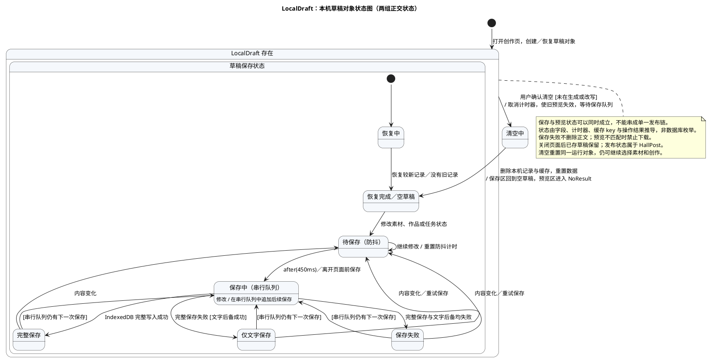

### 5.3 HallPost 大厅帖子对象

| 状态 | 含义 | 状态转移 |
|---|---|---|
| active | 公开展示；可在列表、详情及媒体接口返回 | 发布事务提交后进入；同内容幂等重放和浏览不改变状态 |
| withdrawn | 软撤回；记录、媒体和话题关联仍保留 | 只有匹配 owner 的撤回事件可从 active 进入；重复撤回仍成功 |

非 owner 撤回返回 403，状态不变。撤回后列表排除该帖，详情与图片返回 404。同旧 key 再发布返回 409；使用新 key 重新确认发布会创建另一对象，不是把旧对象恢复为 active。

当前没有恢复、审核中、永久删除状态。withdrawn 不是对象销毁，因此没有从撤回状态连到 UML 终止伪状态。

<!-- diagram: 10_state_post.puml -->

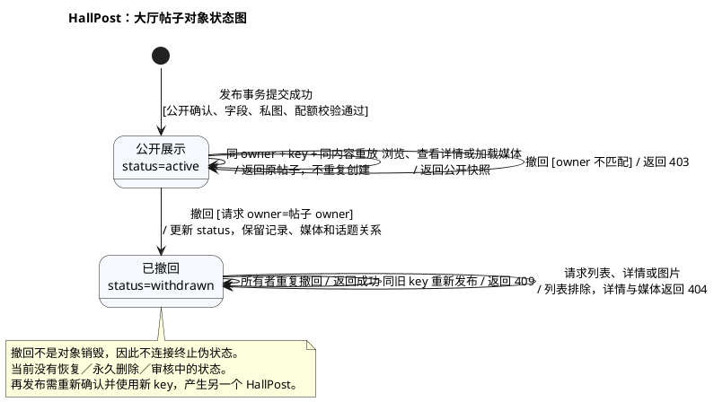

## 六、三个用例事件的活动图

活动图使用 `start` 初始节点、`stop` 活动终止节点、圆角活动节点、带“是／否”守卫的决策及合并节点、`repeat` 循环与泳道。泳道区分用户、浏览器、网站后端及外部服务的责任。

这些业务中的照片分析、地点整理和正文撰写有先后依赖，故不为了展示符号而强行并行。异步派发与前端观察的并发关系在 UC01 时序图中明确表达。状态图关注某个对象如何响应事件，活动图关注整个用例如何从输入走到成果，二者不互相替代。

### 6.1 UC01：一次生成及失败步骤重试

覆盖输入拒绝、素材规范化、并发配额、已有阶段复用、自动定位的条件分支、识图与写作失败、成功结果以及重试循环。定位返回空值是可继续分支。

<!-- diagram: 11_activity_generate.puml -->

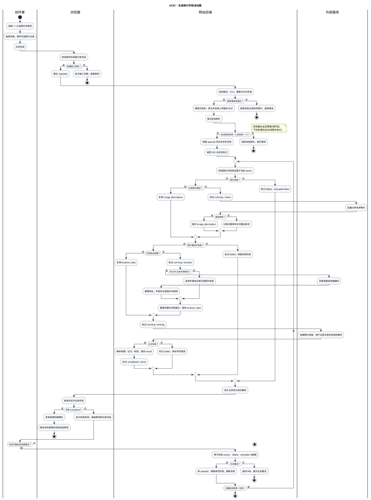

### 6.2 UC02：编辑、更新预览并下载

覆盖可选改写、撤销重做、缓存命中、服务端排版、旧响应丢弃、失败后修正／重试，以及一致性守卫下的 Blob 下载。

<!-- diagram: 12_activity_edit_export.puml -->

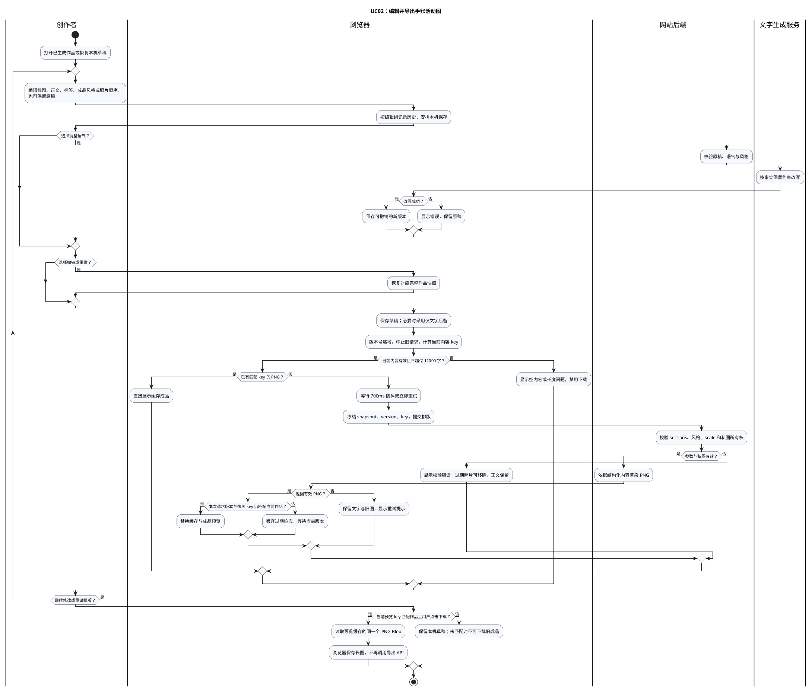

### 6.3 UC03：公开确认、发布及未确认结果重试

覆盖取消公开、字段错误、已有发布重放、额度、照片归属、渲染与事务失败，以及相同 payload 复用 key／修改 payload 换新 key 的循环。

<!-- diagram: 13_activity_publish.puml -->

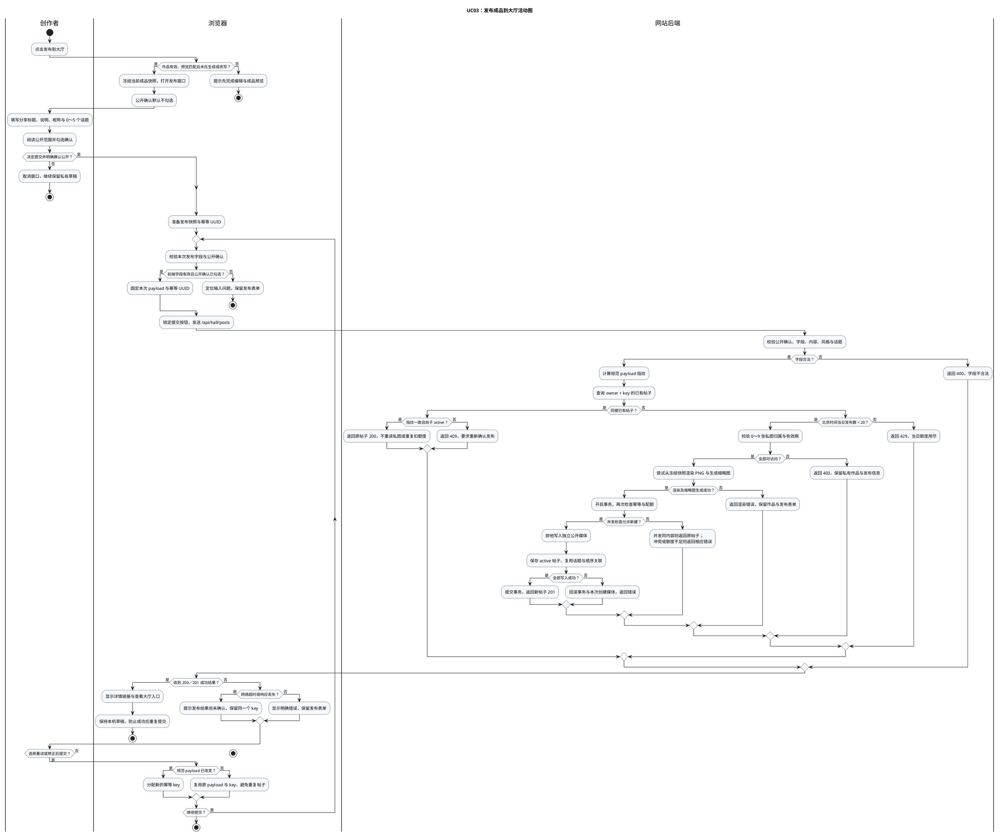

## 七、用例—结构—行为可追踪性

| 用例 | 关键类对象 | 交互图 | 对象状态图 | 活动图 |
|---|---|---|---|---|
| UC01 生成 | GenerationJob、PhotoReference、PrivatePhoto、JournalResult | 05_sequence_generate | 08_state_job | 11_activity_generate |
| UC02 编辑导出 | LocalDraft、JournalSnapshot、RenderedPreview | 06_sequence_edit_export | 09_state_draft | 12_activity_edit_export |
| UC03 发布 | HallPost、PublicMedia、Topic、PostTopic | 07_sequence_publish | 10_state_post | 13_activity_publish |

全局用例图统一 actor 与目标，类图统一对象名称，三个核心用例规约定义成功和失败保障，对应时序图／活动图实现行为追踪，状态图核对对象生命周期。

## 八、源码依据与渲染方式

### 8.1 主要源码依据

| 建模内容 | 当前实现 |
|---|---|
| owner 与会话 | [app.py:72](/Users/lujiahao/Documents/手帐/app.py:72) |
| 上传校验与规范化 | [app.py:238](/Users/lujiahao/Documents/手帐/app.py:238) |
| 分阶段生成与结果 | [app.py:308](/Users/lujiahao/Documents/手帐/app.py:308) |
| 任务持久化、并发、重试、清理 | [storage_service.py:90](/Users/lujiahao/Documents/手帐/services/storage_service.py:90) |
| 发布字段与公开确认 | [app.py:112](/Users/lujiahao/Documents/手帐/app.py:112) |
| 发布幂等与事务媒体 | [hall_service.py:87](/Users/lujiahao/Documents/手帐/services/hall_service.py:87) |
| 软撤回 | [hall_service.py:249](/Users/lujiahao/Documents/手帐/services/hall_service.py:249) |
| 成品预览与缓存一致性 | [app.js:401](/Users/lujiahao/Documents/手帐/static/app.js:401) |
| 草稿序列化与保存 | [app.js:692](/Users/lujiahao/Documents/手帐/static/app.js:692) |
| 发布窗口与固定快照 | [publish.js:120](/Users/lujiahao/Documents/手帐/static/publish.js:120) |
| 导出服务端校验 | [app.py:558](/Users/lujiahao/Documents/手帐/app.py:558) |

### 8.2 如何使用代码

每个 `.puml` 文件均包含完整 `@startuml` 与 `@enduml`，不依赖其他源文件。可单独复制到 PlantUML 编辑器或 VS Code 的 PlantUML 插件中。中文字体使用 PingFang SC；其他系统可替换为 Noto Sans CJK SC 或已安装的中文字体。

用例、类图和状态图采用 Smetana 布局，避免本机必须安装 Graphviz。[PlantUML 官方布局说明](https://plantuml.com/layout-engines)介绍了该选项；时序图与活动图采用其对应原生语法。[状态图语法](https://plantuml.com/state-diagram)、[活动图语法](https://plantuml.com/activity-diagram-beta)。

本机渲染命令示例（在 `docs/uml` 目录中执行，jar 路径按实际安装位置调整）：

```bash
java -Djava.awt.headless=true -jar /path/to/plantuml.jar -charset UTF-8 -tsvg -o images *.puml
java -Djava.awt.headless=true -jar /path/to/plantuml.jar -charset UTF-8 -tpng -o images *.puml
```

交付包含全部 UML 源文件、合并说明、SVG／PNG 图像及 `index.html` 图示预览。此任务只新增设计资料，不改变网站业务代码或用户数据。
